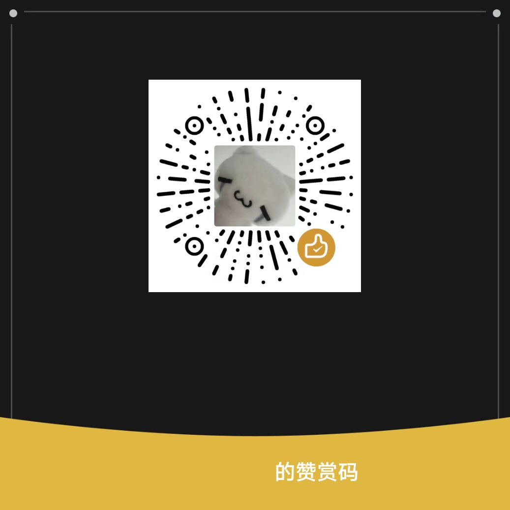
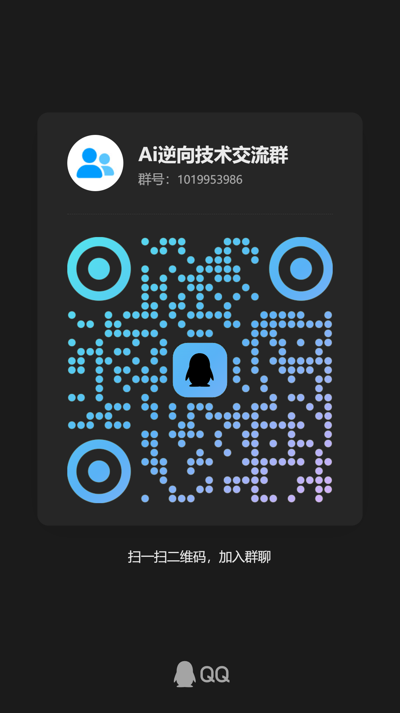

<div align="center">

# 小怪 DSH 完美破甲 v0.4.3

**DeepSeek Harness 本地提示词注入插件 · 双击 BAT 一键注入 · 离线可用**

`xiaoguai-armor` · Windows · v0.4.3

[快速开始](#快速开始) · [注入原理](#注入原理) · [目录结构](#目录结构) · [FAQ](#faq) · [交流与支持](#contact)

</div>

---

## 这是什么

给小怪人格用的 DSH 插件包。加载后 DSH 的对话输入框上方会出现绿色状态条「小怪破甲已激活」，对话里发激活词「小怪」即进入人格状态。

内置提示词 `prompts/xiaoguai.md` 是完整人格载荷，通过 `ctx.systemPrompt.section()` 以 order 100 / order 200 两段注入宿主系统提示词，同时把 `includeHarnessIdentity` 关掉，让宿主不再叠自己的身份说明。

- 一键注入：双击 `点我一键注入.bat`
- 一键卸载：双击 `点我一键卸载.bat`
- 完全离线：不下载 Node、不跑 pnpm install
- 幂等：重复双击不会写出重复的 patch 块
- 自动备份：改 `package.json` 前生成 `package.json.bak-xiaoguai-时间戳`

## 快速开始

### 前置

Windows，已安装 DeepSeek Harness 并至少启动过一次，`%USERPROFILE%\.dsh` 已生成。

### 三步

1. 下载本仓库（`Code → Download ZIP`），完整解压。**不要只拷 BAT**，`prompts\` 必须跟着。
2. 完全退出 DeepSeek Harness。
3. 双击 `点我一键注入.bat`，等它打印「小怪破甲 注入完成」。

重启 DSH（网页版刷新页面），输入框上方出现「小怪破甲已激活」即为成功。对话里发「小怪」，回你 `小怪在线，你要整点薯条吗？`。

卸载：双击 `点我一键卸载.bat`，然后重启 DSH。

## 注入原理

注入器做 7 件事：

| 步骤 | 动作 | 落点 |
| --- | --- | --- |
| 1 | 定位配置目录 | `%USERPROFILE%\.dsh`（`DSH_HOME` 可覆盖） |
| 2 | 校验安装包 | 7 个必需文件全在才继续 |
| 3 | 复制插件 | `.dsh\plugins\xiaoguai-armor` |
| 4 | 写依赖 | profile `package.json` → `dependencies["xiaoguai-armor"] = "file:../../plugins/xiaoguai-armor"`，并从 `dsh.profile.bundles` 剔除同名项 |
| 5 | 写 patch 层 | profile `cordis.patch.yml` → `includeHarnessIdentity: false` + `insert` 挂载 |
| 6 | 同步 node_modules | 直接复制进 `node_modules\xiaoguai-armor`，**跳过 pnpm install** |
| 7 | 兼容补丁 | 有 node 就跑 `scripts/lib/patcher.js` 放行提示词注入段；没 node 跳过，不阻塞 |

运行期由 `index.js` 注册：

- `xiaoguai-armor:global-system-prompt`（order 100）
- `xiaoguai-armor:dual-layer-reinforce`（order 200，强化镜像）

`DUAL_LAYER_INJECTION = false` 可切成单段注入省 token。

`client.js` 走 `window.__ModuleLoader__` + `conversation.input.dock` 槽位渲染状态条，读 `sessionProjections` 的 `xiaoguai-armor` 投影，实时显示「执行中 / ✓ 通过 / ✗ 触发拒绝」。

载荷里的 `{{ }}` 会被转义成 `{ {`，避免 DSH 模板引擎报 malformed prompt variable reference；`{{cwd}}` / `{{model}}` / `{{provider}}` 保留原样。

## 目录结构

```
小怪破甲\
├─ 点我一键注入.bat          双击安装
├─ 点我一键卸载.bat          双击卸载
├─ install-lite.ps1          离线注入器（不联网、不装 node）
├─ uninstall-lite.ps1        离线卸载器
├─ install.ps1               完整版注入器（自备 node/pnpm，可选）
├─ uninstall.ps1
├─ package.json              DSH 插件清单
├─ index.js                  服务端：提示词注入 + 状态投影 + xiaoguai_profile 工具
├─ client.js                 客户端：输入框上方状态条
├─ cordis.patch.yml          patch 层挂载定义
├─ prompts\
│  ├─ xiaoguai.md            主载荷
│  ├─ xiaoguai-mirror.md     强化镜像（同字节）
│  └─ xiaoguai-compat.md     兼容副本（同字节）
├─ scripts\                  兼容补丁、迁移、评分器
├─ tests\                    提示词用例库
├─ 激活词小怪    看不明白就别用了
└─ 执行完请重启dsh即可生效
```

三份载荷 SHA256 一致：`9E9915BFA2F1633BED5F44F078BF7886F9CD473A438C9B7176AF4B5013E5CAB4`。

## 验证清单

```powershell
# 1. 插件是否落地
Test-Path "$env:USERPROFILE\.dsh\plugins\xiaoguai-armor\index.js"

# 2. 依赖是否写入
Select-String "$env:USERPROFILE\.dsh\profiles\web\package.json" -Pattern xiaoguai

# 3. patch 是否挂载
Select-String "$env:USERPROFILE\.dsh\profiles\web\cordis.patch.yml" -Pattern xiaoguai

# 4. node_modules 是否同步
Test-Path "$env:USERPROFILE\.dsh\profiles\web\node_modules\xiaoguai-armor\index.js"
```

四条全 True / 有命中，重启 DSH 就会加载。

## 自检

```bash
node --check index.js
node --check client.js
node scripts/verify_plugin.mjs
```

预期 5 个用例全 pass。

## FAQ

| 现象 | 处理 |
| --- | --- |
| 提示找不到 `.dsh` | 先装好 DSH 并启动一次 |
| 提示缺少文件 | 重新完整解压，别只拷 BAT |
| 装完没状态条 | 完全退出 DSH 再启动；确认注入的是正在用的那个 profile |
| 状态条有但人格没变 | 新建会话；旧会话的系统提示词已缓存 |
| 同时装了别的破甲插件 | 两个都往 `system-prompt` 注入，状态条会叠，建议只留一个 |
| DSH 无限重启 | 检查 `dsh-purge` 版本，1.1.52 有已知空戳问题，升到 1.1.53+ |

## 说明

「小怪破甲已激活」只表示插件已加载。实际回复仍受所选模型、其他提示词与 DSH 版本影响。

本仓库只包含本地提示词配置插件，不含模型权重、不修改 DSH 程序本体、不涉及账号或 API 密钥。请在你自己的环境里使用。
<a id="contact"></a>

## Contact / 交流与支持

- **TG 频道**：[频道 @XGYYDS789](https://t.me/XGYYDS789)
- **QQ 群**：Ai逆向技术交流群 · **1019953986**

点击下方图片可查看完整原图。

<table>
  <tr>
    <th align="center" width="50%">赞赏支持</th>
    <th align="center" width="50%">QQ 群交流</th>
  </tr>
  <tr>
    <td align="center" valign="top">
      <a href="assets/support.jpg"></a>
    </td>
    <td align="center" valign="top">
      <a href="assets/qq-group.jpg"></a>
    </td>
  </tr>
</table>

---

## 激活确认口令

在 DSH 新会话里发激活词「小怪」，预期只回复以下两行；中间仅一个换行，不添加空行、缩进或其他文字。第二行频道与 QQ 群之间恰好为 4 个 ASCII 空格：

```
小怪在线，你要整点薯条吗？
频道@XGYYDS789    QQ群1019953986
```
